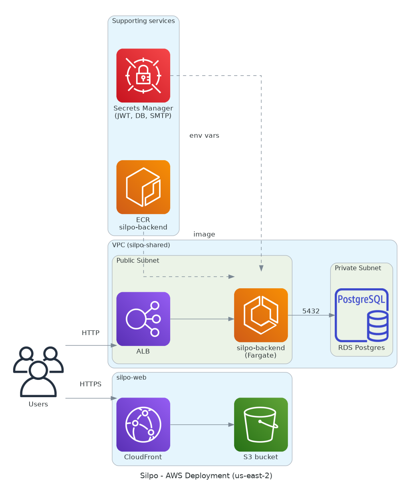

# silpo-iac

Infrastructure as Code for the Silpo project on AWS, using **OpenTofu** (reusable modules,
Terraform-compatible HCL) + **Terragrunt** (environment wiring, remote state, DRY provider
config — Terragrunt 1.x runs OpenTofu by default).

> Traffic assumption driving every default here: at most 3-4 concurrent users, and close to zero
> traffic for ~99% of the day. Every choice below optimizes for that — see
> [Cost trade-offs](#cost-trade-offs).

## Architecture



Generated by [`docs/architecture/diagram.py`](docs/architecture/diagram.py) — kept up to date by
the CI `Diagram` job (see [CI/CD](#cicd)), not by hand.

## Stack

| Layer               | Technology                                      |
| ------------------- | ------------------------------------------------ |
| IaC                 | OpenTofu + Terragrunt                            |
| Cloud               | AWS                                              |
| Compute             | ECS Fargate (single task) + Application Load Balancer |
| Web hosting         | S3 + CloudFront (static SPA, `silpo-web`)        |
| Database            | RDS PostgreSQL (single-AZ, `db.t4g.micro`)       |
| Container registry  | ECR                                              |
| Secrets             | AWS Secrets Manager                              |
| Linting             | `tofu fmt`, `terragrunt hcl fmt`, TFLint         |
| Security scanning   | tfsec                                            |
| Pre-commit hooks    | [pre-commit](https://pre-commit.com) + pre-commit-terraform |
| CI                  | GitHub Actions                                   |

## Repository layout

```
terraform/
  modules/
    networking/    # VPC, public/private subnets, optional NAT gateway
    ecr/            # Container registry for the silpo-backend image
    rds-postgres/   # RDS instance + Secrets Manager secret with connection details
    ecs-service/    # ECS cluster, Fargate service, ALB, task's own app secrets (JWT/SMTP)
    static-site/    # S3 bucket + CloudFront distribution for a static SPA (silpo-web)
    github-oidc-provider/ # GitHub Actions OIDC identity provider (one per AWS account)
terragrunt/
  terragrunt.hcl    # Root config: S3 remote state (native locking) + AWS provider generation
  live/
    shared/         # The one environment this project runs (see "Environments" below)
      env.hcl       # account_id / aws_region / environment name
      networking/
      ecr/
      rds/
      github-oidc/  # GitHub Actions OIDC provider, consumed by api/web's deploy roles
      api/
      web/
```

No custom domain yet: both `api` and `web` are reached through CloudFront's own default
`*.cloudfront.net` domains (that default domain comes with its own CloudFront-issued
certificate — no ACM cert or Route53 zone needed), via `ecs-service`'s `enable_cloudfront` and
`static-site`'s always-on CloudFront respectively. `api`'s CloudFront distribution sits in front
of the ALB purely to get a real HTTPS endpoint — without it, `web` (HTTPS) couldn't call `api`
(would otherwise be plain HTTP) at all, since browsers block that "mixed content" combination. If
a domain is registered later, both `ecs-service` and `static-site` already support `domain_name` /
`certificate_arn` / `zone_id` inputs — wiring those back in (which also turns off `api`'s
CloudFront passthrough, see `enable_cloudfront`'s description) plus a `dns` unit/module to issue
the ACM certs is a natural next step at that point.

`silpo-mobile` (Expo/React Native) has no unit here — it isn't deployed to AWS. Distribution goes
through the app stores, and builds/OTA updates through Expo's own EAS service.

## Environments

This project runs a **single environment** (`shared`), not separate `dev`/`staging`/`prod` stacks.
Running a full second copy (ALB + RDS + Fargate) would roughly double the fixed monthly cost for
a project with this little traffic, so it wasn't worth it. If that changes (e.g. real users,
need for a safe place to test destructive changes), copy `terragrunt/live/shared/` to a new
`terragrunt/live/<name>/` folder with its own `env.hcl` — every module already supports it.

## Cost trade-offs

Defaults here explicitly trade a bit of resilience/observability for a lower, mostly-fixed bill:

- **No NAT gateway** (`enable_nat_gateway = false` in `networking`). A NAT gateway costs ~US$32-38/month
  just sitting idle — often more than the rest of this stack combined at this traffic level. Instead,
  the ECS Fargate task runs in the **public** subnets with a public IP (`assign_public_ip = true` in
  the `api` unit). This does *not* expose the app directly: the task's security group only allows
  inbound traffic from the ALB's security group, so a public IP on the task doesn't make it reachable
  from the internet. RDS stays in the private subnets and never needs outbound internet access, so it
  doesn't need NAT either.
- **Single-AZ RDS**, `db.t4g.micro`, no read replica. Enough for a handful of users; `multi_az = true`
  would double the RDS cost for redundancy this project doesn't need yet.
- **Smallest Fargate task** (256 CPU units / 512 MiB), `desired_count = 1`. No autoscaling — one task
  is enough for a handful of concurrent users, and it's the cheapest way to keep the API always
  reachable (Fargate bills per second while running, so this is the actual cost floor, not a burst
  limit).
- **Container Insights disabled** by default (`enable_container_insights = false` in `ecs-service`) —
  it adds CloudWatch metrics cost for observability this project doesn't need day to day.
- **`silpo-web` on S3 + CloudFront** (`static-site` module), not another Fargate service. Static
  hosting bills per request/GB served, not per second of uptime — at this traffic it's cents/month,
  not another ~US$20-30 of always-on compute. `PriceClass_100` (North America + Europe edge
  locations only) keeps it cheap; WAF and access logging are left off for the same cost reason.

**No custom domain** — this project doesn't register one, so there's no Route53 hosted zone fee
(~US$0.50/month) or annual registrar fee on top of the estimate below. `api` and `web` are reached
through CloudFront's own default AWS domains instead (see [Repository layout](#repository-layout)),
which is also why `api` gets its own CloudFront distribution (`enable_cloudfront`) in front of the
ALB — a bit of extra CloudFront cost (same per-request/GB pricing as `web`'s, cents/month at this
traffic) in exchange for an HTTPS endpoint `web` can actually call without a domain.

For the actual resource-by-resource number, on-demand pricing, excluding AWS free tier — see
[Cost estimate](#cost-estimate) below, generated from this repo's own code rather than typed by
hand.

**If you need to go lower than that**: the only way to actually get near US$0 during idle hours is to
stop running the API 24/7 — e.g. port `silpo-backend` to run on AWS Lambda (behind API Gateway
instead of an ALB, using an ASGI adapter like [Mangum](https://github.com/jordaneremieff/mangum)) so
you pay per request instead of per second of uptime. That's a `silpo-backend` code change, not just
infra, so it's deliberately out of scope here — flag it if the AWS bill becomes worth optimizing
further.

## Cost estimate

Generated by [Infracost](https://www.infracost.io/) from [`infracost.yml`](infracost.yml) (one
project per module, using the same representative values as
`terragrunt/live/shared/*/terragrunt.hcl`), kept up to date by the `Cost` CI job — see
[CI/CD](#cicd). Static analysis, no AWS credentials or deployed infrastructure involved, so it's
an estimate, not a bill.

<!-- infracost-start -->
```text
Project: networking
Module path: terraform/modules/networking

 Name           Monthly Qty  Unit  Monthly Cost   
                                                  
 Project total                            $0.00   

──────────────────────────────────
Project: ecr
Module path: terraform/modules/ecr

 Name                       Monthly Qty  Unit            Monthly Cost   
                                                                        
 aws_ecr_repository.this                                                
 └─ Storage               Monthly cost depends on usage: $0.10 per GB   
                                                                        
 Project total                                                  $0.00   

──────────────────────────────────
Project: rds-postgres
Module path: terraform/modules/rds-postgres

 Name                                                             Monthly Qty  Unit                    Monthly Cost   
                                                                                                                      
 aws_db_instance.this                                                                                                 
 ├─ Database instance (on-demand, Single-AZ, db.t4g.micro)                730  hours                         $11.68   
 ├─ Storage (general purpose SSD, gp3)                                     20  GB                             $2.30   
 └─ Additional backup storage                               Monthly cost depends on usage: $0.095 per GB              
                                                                                                                      
 aws_secretsmanager_secret.this                                                                                       
 ├─ Secret                                                                  1  months                         $0.40   
 └─ API requests                                            Monthly cost depends on usage: $0.05 per 10k requests     
                                                                                                                      
 Project total                                                                                               $14.38   

──────────────────────────────────
Project: ecs-service
Module path: terraform/modules/ecs-service

 Name                                           Monthly Qty  Unit                    Monthly Cost   
                                                                                                    
 aws_lb.this                                                                                        
 ├─ Application load balancer                           730  hours                         $16.43   
 └─ Load balancer capacity units          Monthly cost depends on usage: $5.84 per LCU              
                                                                                                    
 aws_ecs_service.this                                                                               
 ├─ Per GB per hour                                     0.5  GB                             $1.62   
 └─ Per vCPU per hour                                  0.25  CPU                            $7.39   
                                                                                                    
 aws_secretsmanager_secret.jwt_secret                                                               
 ├─ Secret                                                1  months                         $0.40   
 └─ API requests                          Monthly cost depends on usage: $0.05 per 10k requests     
                                                                                                    
 aws_secretsmanager_secret.smtp_password                                                            
 ├─ Secret                                                1  months                         $0.40   
 └─ API requests                          Monthly cost depends on usage: $0.05 per 10k requests     
                                                                                                    
 aws_secretsmanager_secret.smtp_username                                                            
 ├─ Secret                                                1  months                         $0.40   
 └─ API requests                          Monthly cost depends on usage: $0.05 per 10k requests     
                                                                                                    
 aws_cloudwatch_log_group.this                                                                      
 ├─ Data ingested                         Monthly cost depends on usage: $0.50 per GB               
 ├─ Archival Storage                      Monthly cost depends on usage: $0.03 per GB               
 └─ Insights queries data scanned         Monthly cost depends on usage: $0.005 per GB              
                                                                                                    
 Project total                                                                             $26.64   

──────────────────────────────────
Project: static-site
Module path: terraform/modules/static-site

 Name                                                    Monthly Qty  Unit                    Monthly Cost   
                                                                                                             
 aws_cloudfront_distribution.this                                                                            
 ├─ Invalidation requests (first 1k)               Monthly cost depends on usage: $0.00 per paths            
 └─ US, Mexico, Canada                                                                                       
    ├─ Data transfer out to internet (first 10TB)  Monthly cost depends on usage: $0.085 per GB              
    ├─ Data transfer out to origin                 Monthly cost depends on usage: $0.02 per GB               
    ├─ HTTP requests                               Monthly cost depends on usage: $0.0075 per 10k requests   
    └─ HTTPS requests                              Monthly cost depends on usage: $0.01 per 10k requests     
                                                                                                             
 aws_s3_bucket.this                                                                                          
 └─ Standard                                                                                                 
    ├─ Storage                                     Monthly cost depends on usage: $0.023 per GB              
    ├─ PUT, COPY, POST, LIST requests              Monthly cost depends on usage: $0.005 per 1k requests     
    ├─ GET, SELECT, and all other requests         Monthly cost depends on usage: $0.0004 per 1k requests    
    ├─ Select data scanned                         Monthly cost depends on usage: $0.002 per GB              
    └─ Select data returned                        Monthly cost depends on usage: $0.0007 per GB             
                                                                                                             
 Project total                                                                                       $0.00   

 OVERALL TOTAL                                                                                     $41.02 

*Usage costs can be estimated by updating Infracost Cloud settings, see docs for other options.

──────────────────────────────────
48 cloud resources were detected:
∙ 11 were estimated
∙ 37 were free

┏━━━━━━━━━━━━━━━━━━━━━━━━━━━━━━━━━━━━━━━━━━━━━━━━━━━━┳━━━━━━━━━━━━━━━┳━━━━━━━━━━━━━┳━━━━━━━━━━━━┓
┃ Project                                            ┃ Baseline cost ┃ Usage cost* ┃ Total cost ┃
┣━━━━━━━━━━━━━━━━━━━━━━━━━━━━━━━━━━━━━━━━━━━━━━━━━━━━╋━━━━━━━━━━━━━━━╋━━━━━━━━━━━━━╋━━━━━━━━━━━━┫
┃ networking                                         ┃         $0.00 ┃           - ┃      $0.00 ┃
┃ ecr                                                ┃         $0.00 ┃           - ┃      $0.00 ┃
┃ rds-postgres                                       ┃           $14 ┃           - ┃        $14 ┃
┃ ecs-service                                        ┃           $27 ┃           - ┃        $27 ┃
┃ static-site                                        ┃         $0.00 ┃           - ┃      $0.00 ┃
┗━━━━━━━━━━━━━━━━━━━━━━━━━━━━━━━━━━━━━━━━━━━━━━━━━━━━┻━━━━━━━━━━━━━━━┻━━━━━━━━━━━━━┻━━━━━━━━━━━━┛
```
<!-- infracost-end -->

## Prerequisites

- [OpenTofu](https://opentofu.org/docs/intro/install/) `>= 1.7` (Terragrunt invokes `tofu` by
  default; a Terraform CLI install works too, but then pass `--tf-path terraform` to every
  Terragrunt command)
- [Terragrunt](https://terragrunt.gruntwork.io/docs/getting-started/install/) `>= 1.0`
- [TFLint](https://github.com/terraform-linters/tflint) (optional locally, runs in CI)
- AWS credentials with permission to create the resources in `terraform/modules/*`

## One-time bootstrap

1. **Set the real AWS account ID.** Edit `terragrunt/live/shared/env.hcl` and replace the
   placeholder `account_id`. This namespaces the Terraform state bucket
   (`silpo-terraform-state-<account_id>`) so it doesn't collide with anyone else's AWS account.
2. **Set the real SMTP credentials.** Terraform can't invent a real mailbox login, so it's not
   a committed input:
   ```bash
   cp terragrunt/live/shared/api/secrets.tfvars.example terragrunt/live/shared/api/secrets.tfvars
   ```
   Edit `secrets.tfvars` (git-ignored) and fill in the real `smtp_username`/`smtp_password`
   (for Gmail, `smtp_password` must be an app password, not the account password). Also update
   the `EMAIL_FROM` value in `terragrunt/live/shared/api/terragrunt.hcl` to match that mailbox.
   Skipping this step is fine — both default to an empty string — but email sending won't work
   until they're set and the `api` unit is re-applied.
3. **Apply.** The `--backend-bootstrap` flag has Terragrunt create the S3 state bucket
   automatically if it doesn't exist yet (state locking uses S3's own native locking, no
   DynamoDB table needed) — no separate bootstrap step:
   ```bash
   cd terragrunt/live/shared
   terragrunt apply --all --backend-bootstrap
   ```
   Terragrunt resolves the dependency order itself: `networking` → `ecr`/`rds` → `api`.
4. **Wire up `silpo-backend`'s deploy.** The `api` unit provisions a `deploy` IAM role that
   `silpo-backend`'s own CI assumes via the `github-oidc` unit's OIDC provider — see the
   `deploy` job in `silpo-backend/.github/workflows/ci.yml`. The `ecr` unit's
   `image_tag_mutability` is `MUTABLE` specifically so that job can keep re-pushing the
   `:latest` tag the `api` unit's task definition always deploys. After applying, set these as
   **repository variables** in `silpo-backend`'s GitHub repo settings, from this stack's
   outputs:
   - `AWS_DEPLOY_ROLE_ARN` ← `api` unit's `deploy_role_arn` output
   - `AWS_ECR_REPOSITORY_URL` ← `ecr` unit's `repository_url` output
   - `AWS_ECS_CLUSTER` ← `api` unit's `ecs_cluster_name` output
   - `AWS_ECS_SERVICE` ← `api` unit's `ecs_service_name` output

   Once set, every push to `silpo-backend`'s `main` branch builds and pushes a new image, then
   forces the ECS service to redeploy it.
5. **Wire up `silpo-web`'s deploy.** The `web` unit provisions a `deploy` IAM role that
   `silpo-web`'s own CI assumes via the `github-oidc` unit's OIDC provider (no long-lived AWS
   keys in GitHub) — see the `deploy` job in `silpo-web/.github/workflows/ci.yml`. After
   applying, set these as **repository variables** (not secrets — none of them are sensitive)
   in `silpo-web`'s GitHub repo settings (Settings → Secrets and variables → Actions →
   Variables), from this stack's `web` unit outputs:
   - `AWS_DEPLOY_ROLE_ARN` ← `deploy_role_arn`
   - `AWS_S3_BUCKET` ← `bucket_name`
   - `AWS_CLOUDFRONT_DISTRIBUTION_ID` ← `distribution_id`
   - `VITE_API_BASE_URL` ← `https://` + the `api` unit's `cloudfront_domain_name` output (no
     custom domain yet, so this is an AWS-generated hostname, not a fixed URL — re-set this
     variable if that CloudFront distribution is ever recreated)

   Once set, every push to `silpo-web`'s `master` branch builds with that `VITE_API_BASE_URL`,
   syncs `dist/` to the bucket, and invalidates the CloudFront cache automatically.

## CI/CD

`.github/workflows/ci.yml` runs on every push and pull request:

- **Lint** — `tofu fmt -check`, `terragrunt hcl fmt --check`, TFLint
- **Test** — `tofu validate` per module (no AWS credentials needed) + `tfsec` security scan
- **Cost** — [Infracost](https://www.infracost.io/) breakdown from [`infracost.yml`](infracost.yml)
  (static analysis per module, no AWS credentials needed — same reasoning as `Test`). Needs a
  free account: sign up at infracost.io, then set repo secret `INFRACOST_API_KEY` to your API
  key (Org Settings → API Keys) — without it this job fails outright (no silent skip, unlike the
  old `Build` job). Not a required status check. Same self-commit rule as `Diagram` below: only
  on push to `develop`, updating the [Cost estimate](#cost-estimate) section of this README.
- **Diagram** — renders [`docs/architecture/diagram.py`](docs/architecture/diagram.py) (Python
  [`diagrams`](https://diagrams.mingrammer.com/) library, official AWS icons) into
  `docs/architecture/architecture.png` (the image embedded above), no AWS credentials needed
  since it's hand-described, not derived from a live plan. Runs after (`needs:`) `Lint` and
  `Test` have already passed for the same commit. Not itself a required status check —
  informational only. Runs (render + artifact + job summary) on every push and PR, but only
  self-commits on `push` to **`develop`** — never `main`. `main` only ever changes through a
  manually-reviewed `develop -> main` PR that someone merges themselves (see
  [Branching](#branching)); letting this bot commit to `main` independently was tried and
  reverted, since a bot-authored fix landing only on `main` is exactly how `main` and `develop`
  end up with diverging history (it happened once while building this — see the `50ee178`/
  `8a27250` commits in the repo history for what that looked like).

  On a qualifying push to `develop`, if the rendered image differs from the one committed, it
  opens a PR with the refresh — authenticated as `DIAGRAM_BOT_TOKEN` (a fine-grained PAT scoped
  to just this repo, belonging to a user in `bypass_pull_request_allowances`) instead of the
  default `GITHUB_TOKEN`, since the built-in token can't trigger `pull_request` workflows on a PR
  it opens itself (GitHub's own loop-prevention) — and then immediately merges that PR itself
  with an admin override (`gh pr merge --admin`). That's the one specific case in this repo that
  merges into a protected branch without a human clicking approve; "gated on checks" here means
  the merge step is only reached once `Lint`/`Test` succeeded on the original commit, not that
  GitHub's own protections are checked again for the PR — the admin override skips those outright
  (a plain `--auto` merge doesn't work for this: bypassing the required-review count only applies
  to a direct push or an explicit admin-override merge, not to GitHub's passive
  merge-when-checks-pass queue — confirmed by hitting exactly that wall while building this).
  Update `diagram.py` itself by hand alongside any change to what's actually provisioned; the
  image on `develop` follows automatically on the next push, and reaches `main` the same way
  everything else does — via the next manual promotion.

  **Trade-off worth knowing:** `DIAGRAM_BOT_TOKEN` is stored as a repo secret and belongs to an
  account that can bypass PR review on `main`/`develop`. If it ever leaked, whoever has it could
  merge anything into either branch without review or waiting on checks. Scoped to just this one
  repository specifically to limit that blast radius.

`Lint` and `Test` (but not `Diagram` or `mirror-gitlab`) are required status checks on `main` and
`develop`.

## Branching

`develop` is where everything lands first — feature branches target it, and it's always the
same as or ahead of `main`, never behind. `main` only moves forward through a manually-reviewed
`develop -> main` PR that a person merges themselves; nothing in this repo's automation (the
`Diagram` job included — see [CI/CD](#cicd)) pushes or self-merges into `main` directly. If
`main` ever has commits `develop` doesn't, something bypassed that rule; reconcile by merging
`main` back into `develop` before continuing.

## Conventions

Same as `silpo-backend`: `<tipo>/<descricao>` branches in `kebab-case`, Conventional Commits,
`[TIPO] Descrição objetiva` PR titles, PRs against `develop`.
